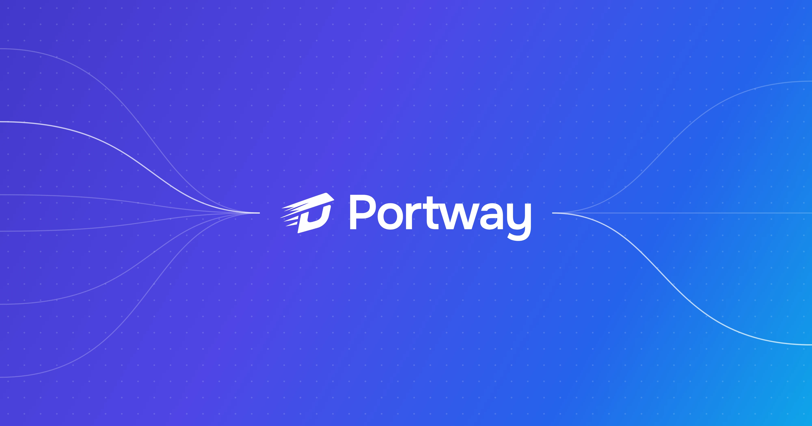

---

[](LICENSE)
[](https://github.com/melosso/portway/commits/main)
[](https://github.com/melosso/portway/releases/latest)
[](https://github.com/melosso/portway/stargazers)

Portway is an open source API gateway.

- Documentation: [Github Pages](https://melosso.github.com/portway)
- Deploy: [Install Portway](https://melosso.github.io/portway/guide/install/)
- Demo: [Visit Instance](https://portway-demo.melosso.com/)

Built for databases, internal services and webhooks. Configuration is easy and file-based. Built in options: caching, audit logging, MCP, OData, Azure Key Vault secrets, rate limiting, and Prometheus or OTLP metrics.

## Getting Started

### Installation

* [Docker](https://melosso.github.io/portway/guide/deployment-docker/)
* [Linux](https://melosso.github.io/portway/guide/deployment-linux/)
* [Windows Server](https://melosso.github.io/portway/guide/deployment-windows/)

### Define Your Environments

Environments isolate server and connection settings for all endpoints. Follow the native web-console or instead configure your API manually. The `environments/settings.json` configures the allowed environments; each has its own `settings.json`:

**`environments/settings.json`**

```json
{
  "Environment": {
    "ServerName": "localhost",
    "AllowedEnvironments": ["prod", "dev"]
  }
}
```

**`environments/prod/settings.json`**

```json
{
  "ServerName": "localhost",
  "ConnectionString": "Server=localhost;Database=prod;Trusted_Connection=True;Connection Timeout=5;TrustServerCertificate=true;"
}
```

### Define Your Endpoints

Each endpoint is an `entity.json` file in a directory per type. Advanced configuration is in the [documentation](https://melosso.github.io/portway/). Endpoint types:

* **SQL** (SQL Server, PostgreSQL, MySQL, SQLite): Direct CRUD access with schema-level control and documentation
* **Proxy**: Forward to internal services; supports complex orchestration
* **Composite**: Chain multiple endpoint calls into one transaction
* **File System**: Read/write from local storage or cache (In memory and/or Redis)
* **Webhook**: Receive external calls and persist data to SQL
* **Static**: read static files or set up a mock endpoint

Configuration and usage examples for each type are shown in the [Endpoints](https://melosso.github.io/portway/guide/endpoints/).

### Deploy

The [install guide](https://melosso.github.io/portway/guide/install) describes Docker, Linux and Windows Server installs, application pool identity for proxies, security settings and production hardening.

### Connect

Every `/api` request requires a bearer token. The token is scoped to its endpoints and environments.

```bash
curl -H "Authorization: Bearer YOUR_TOKEN_HERE" https://your-host/api/{env}/{endpoint}
```

Portway is an MCP server over HTTP at `/mcp`. Endpoints with MCP enabled are tools for any MCP client. MCP is enabled per endpoint. Each tool call uses the client's own token and environment scope.

The [security guide](https://melosso.github.io/portway/guide/security) and [MCP guide](https://melosso.github.io/portway/guide/mcp) describe tokens, scopes and client setup.

---

## Documentation

The OpenAPI documentation endpoint is configurable and can be disabled.

### Interactive documentation
The application uses [Scalar](https://github.com/scalar/scalar) to render your OpenAPI specification as interactive API documentation. `/docs` displays endpoints, request and response schemas and a request client, generated from the endpoint configuration.

### Walkthrough
The [documentation](https://melosso.github.io/portway/) describes setup, usage and advanced configuration, with configuration examples for each endpoint type and complete application examples.

## Contribution 

Contributions are welcome, please submit a PR if you'd like to help improve the project.

## License

Licensed under the **EUPL-1.2**. For more information, please see the [license](LICENSE) file.
